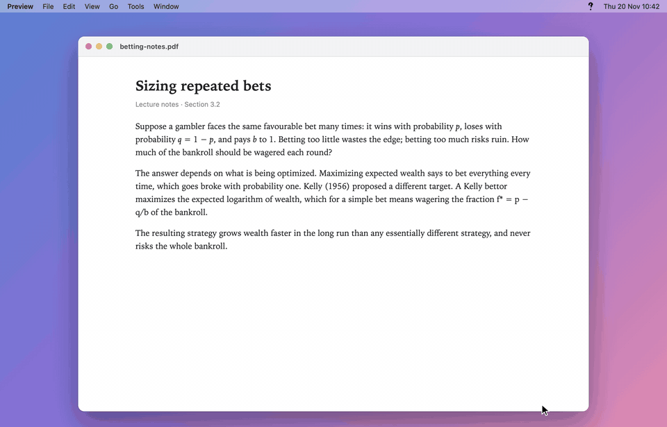
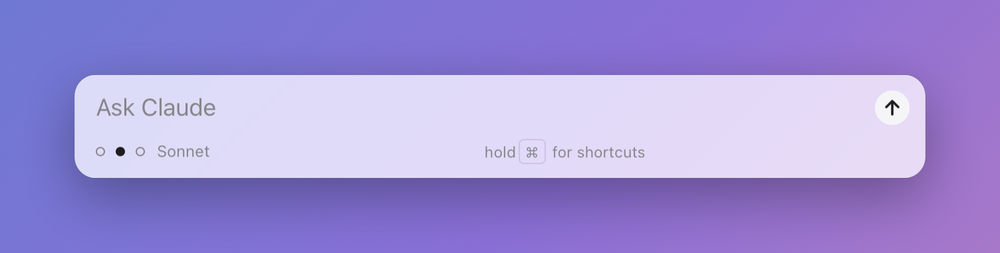
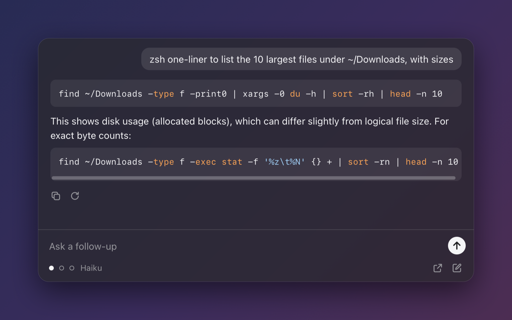

# Quick Ask

A small macOS menu-bar app for asking your AI agent a quick question. 
Press ⌥Space, ask, and read the answer in a floating popup, without leaving what you're doing. 
It runs the agent CLI you already have installed and signed in to (currently just Claude Code; uses your Claude subscription). The CLI gets web search and a scratch
folder of its own.



<sub>Rendered from the real popup UI with a scripted conversation; the answer is
a real Claude answer ([MP4](docs/demo.mp4)).</sub>

## Why I made this

The Claude desktop app has a quick-entry shortcut (⌥⌥ by default), but once you
send, it switches you to the desktop app. Usually I just want a quick answer
right where I am, with no app or window switching and no chat history to clean up.

## Features

- **Answers inline.** Streamed markdown with math (KaTeX) and highlighted code.
  Follow-ups continue the conversation.
- **Selected text as context.** If text is selected when you press the hotkey,
  it's attached as a quote to your question.
- **Model choice.** Haiku, Sonnet or Opus from the speed dial in the popup (⌘1–3).
- **Tools.** Web search and page fetching, and file tools confined to a
  per-conversation scratch folder. No shell or code execution.
- **Ephemeral by default.** A conversation is kept for 10 minutes after you close
  the popup (configurable), then its CLI session and scratch folder are deleted.
- **Hand-off.** ⌘O continues the same session in the Claude desktop app (Code
  tab); ⇧⌘O opens it as a new chat.
- **Settings.** Hotkey, open at login, default model, web search on or off,
  extra instructions.

| | |
|---|---|
|  |  |

## How it works

A native Swift app: a floating, non-activating `NSPanel` with a blurred
background, holding a `WKWebView` that renders the chat (markdown-it, KaTeX,
highlight.js, all bundled). Each question runs the CLI headless:

```bash
claude -p --session-id <id> --name "<first question>" \
  --output-format stream-json --include-partial-messages --verbose \
  --restricted --tools WebSearch,WebFetch,Read,Write,Edit,Glob,Grep \
  --allowedTools <same> --permission-prompts none \
  --strict-mcp-config --setting-sources= \
  --system-prompt "<short-answer instructions>" --model sonnet
```

The question goes in on stdin. The app parses the JSON event stream for text
deltas and tool activity, and follow-ups use `--resume <id>`. The CLI runs in
the app's own folder with a clean environment: no user settings, plugins, hooks
or MCP servers. Selected text is read with the Accessibility API, falling back
to a simulated ⌘C with the clipboard restored. Everything CLI-specific lives in
one provider (`Sources/QuickAsk/Agents/ClaudeCodeProvider.swift`), so another
agent CLI (e.g. Codex) can be added as a second provider.

## Build

Requires macOS 14+, the Xcode command line tools, and a signed-in `claude` CLI.

```bash
./build.sh --install
```

This builds `build/Quick Ask.app`, signs it ad hoc, copies it to `~/Applications`
and starts it. Reading selected text needs the Accessibility permission; the
popup offers to enable it.

<details>
<summary>Keys</summary>

| Key | Action |
|---|---|
| ⌥Space | Show or hide (change it in Settings) |
| ↵ / ⇧↵ | Send / new line |
| ⌘C (nothing selected) | Copy the last answer |
| ⌘R / ⌘. | Retry / stop |
| ⌘N | New chat |
| ⌘O / ⇧⌘O | Continue in the Claude desktop app / open as a new chat |
| ⌘1–⌘3 | Haiku / Sonnet / Opus |
| ⌘, | Settings |
| Esc | Hide |
| Hold ⌘ | Show the shortcuts that apply |

</details>

The README media are rendered by `demo/make.sh` (needs ffmpeg). Planned work
is tracked in [TODO.md](TODO.md).
